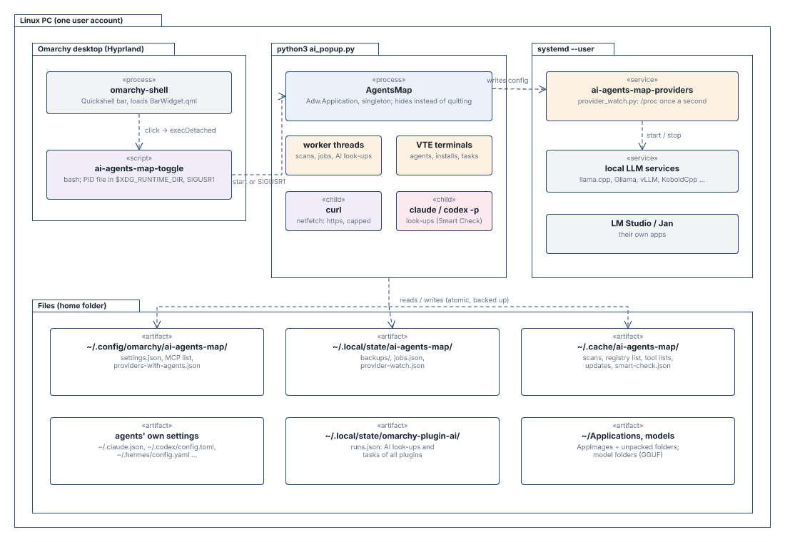
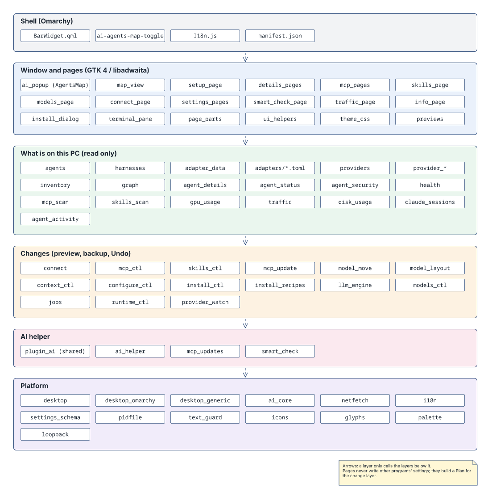
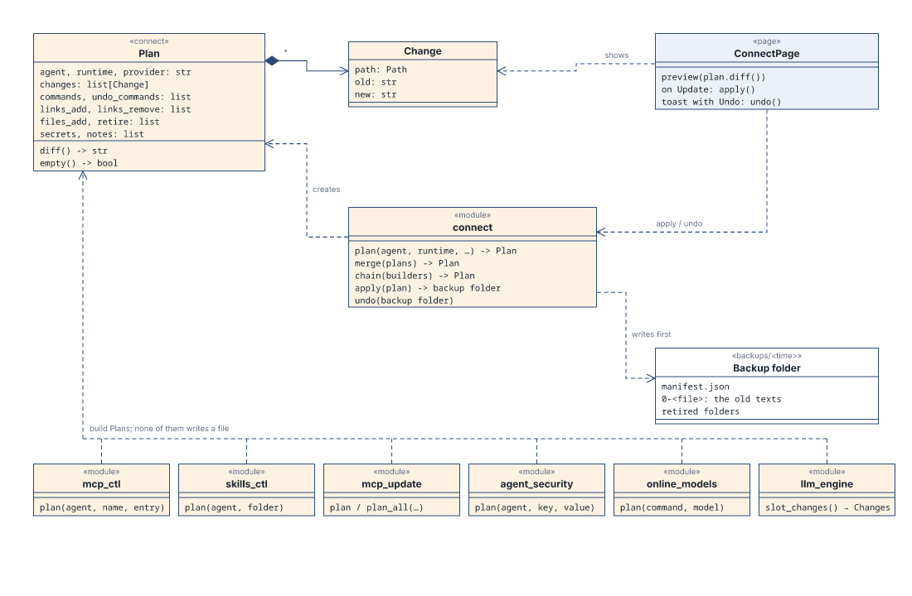
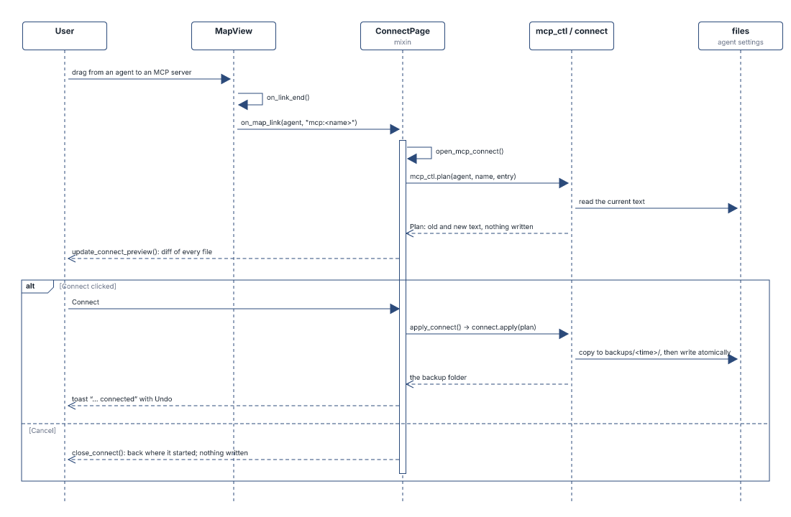
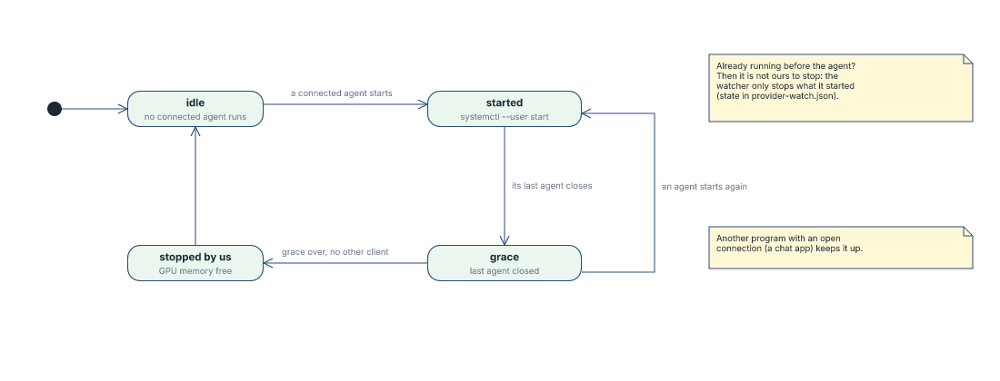
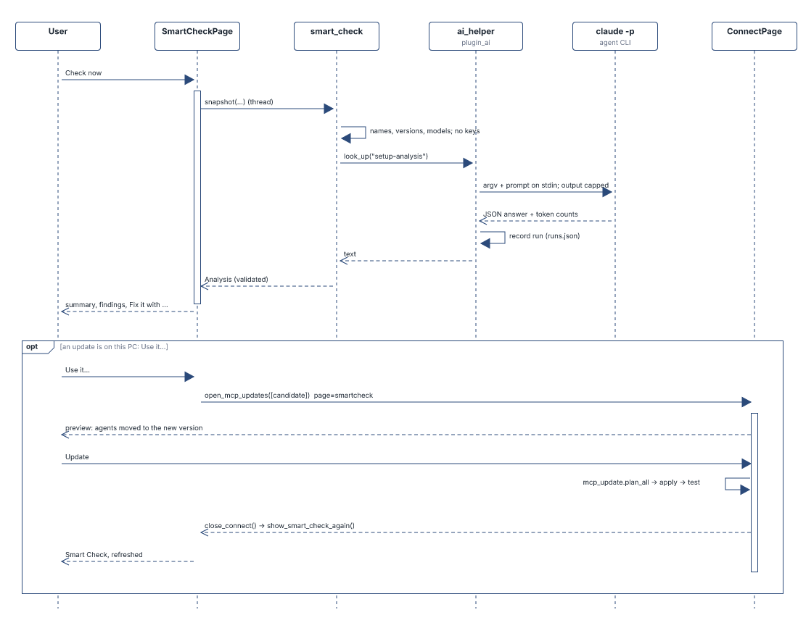

# AI Agents Map: architecture for reviewers

This page is a map of the code for anyone reviewing AI Agents Map. It shows where the processes run,
how the modules are layered and which function each risky operation goes through, so a review can
start at those places. The README's **Privacy and capabilities** section is the full list of what
the plugin reads, writes, starts and fetches. This page says **where in the code** that happens.

Names are real module and function names of the commit this file is in. The diagrams come from the
technical manual (UML 2, drawn from a script), so they show structure, not every detail.

## In one paragraph

A Python 3 / GTK 4 app (`ai_popup.py`, class `AgentsMap`) started from the bar through a bash toggle
script. Opening the window only reads files and `/proc`. Nothing is started, installed or sent until
the user clicks. Every change to another program's settings is a `connect.Plan`: it is shown as a diff,
the old files are backed up, the new ones are written atomically, and Undo puts the old ones back. One
optional user service (`provider_watch.py`) starts and stops local LLM servers together with the agents
that use them. There is no root process and no shell: children are argv lists, and the one terminal
command line is shlex-quoted word by word.

## Processes and files

- **Bar → toggle.** `BarWidget.qml` only runs `ai-agents-map-toggle`. The script keeps a PID file in
  `$XDG_RUNTIME_DIR` (or a private 0700 fallback). It signals (`SIGUSR1`) a PID only after checking
  uid, interpreter, exact script path and kernel start time. Same checks in Python: `pidfile.py`.
- **App.** `ai_popup.py` holds itself (`Adw.Application.hold`): closing hides the window, the next
  click shows it. Slow work runs on worker threads and comes back with `GLib.idle_add`.
- **Service.** `ai-agents-map-providers.service` exists only while *Settings › Start local LLMs with
  their agents* is on (`provider_watch.ensure_service`). It reads `providers-with-agents.json`
  through `provider_watch.read_config`, which keeps only runtime keys, unit names and ports that pass
  `NAME_RE` / `_entry` (64 KiB cap). The service builds its `systemctl --user` commands itself and
  never takes a command line from the file.

## Layers

Pages (blue) read the model of the PC (green) and build plans in the change layer (orange). Everything
that touches the outside world is in the platform layer at the bottom. **A review can concentrate on
that layer and on the change layer.** The pages above them call into these.

## Where each risky operation goes through

| Operation | Goes through | Notes |
| --- | --- | --- |
| Run a program, read its output | `ai_core.read_bounded_output` | argv list, no shell, byte cap + one deadline; secrets on stdin |
| AI look-ups (`claude -p`, `codex exec`) | `plugin_ai.run_bounded` via `plugin_ai.look_up` / `ai_helper.look_up` | own session, agent-session variables removed (`clean_env`), output capped, answer validated (`smart_check.validate`, `mcp_updates`), never run |
| Anything from the web | `netfetch.fetch` / `fetch_json` | curl, https only (`_check`), redirects counted, headers in curl's config on stdin (`_quote`), size + time caps |
| Downloads (LLM servers, models) | `install_ctl.download`, `install_ctl.sha256_of` | `.part` file opened without following links, published SHA-256 checked before unpacking, `MAX_DOWNLOAD` / `MAX_UNPACKED` |
| Move or copy model files (Models page, Reorganize) | `model_move.move_file`, `model_layout._move` → `_copy` | Reorganize reaches each source through `_open_parent` (walked from `/` one folder at a time with `O_NOFOLLOW`, since the plan holds real paths) and it must still be the file the preview recorded (`Step.ident`, device and inode); the source is opened once without following links (`_open_own`, folder entries relative to the folder's descriptor) and must be this account's own regular file or folder; the copy reads only that descriptor into a 0600 `.part`, and the source is removed only if it is still the same file (`_same_file` / `_identity`) |
| Change another program's settings | `connect.apply`, `connect.undo` | backup + `manifest.json` (0600) first, atomic write (temp, fsync, rename), owner-only mode kept, new files 0600; Undo leaves a file alone that was changed again since |
| Claude Code's MCP list | `mcp_ctl._claude_json_change` → `connect.apply` | `~/.claude.json` edited as one planned change, refused if Claude wrote it in the meantime; deliberately **not** `claude mcp add-json`, whose argv (keys in env, headers, URL) other accounts could read in `/proc/<pid>/cmdline` |
| Commands in a terminal the user watches | `desktop_omarchy.run_in_terminal` / `run_steps_in_terminal` | every word shlex-quoted; `sudo` only for system-package installs, password typed in that terminal (`install_dialog`) |
| systemd user units | `provider_watch` (`systemctl --user`), `install_ctl` (units it writes) | only units it installed or that start a local LLM; unit paths refuse `%`, quotes, `$`, backslashes, control characters |
| Local LLM APIs on 127.0.0.1 | `netfetch.fetch(local=True)` after `loopback.require_own_listener` | only listeners owned by this user (`/proc/net/tcp` uid column) |
| Credentials | `agent_status.credentials_present` | checks only whether a credential file **exists**; credential files are never opened |
| Paste into text fields | `text_guard.TextGuard` | `wl-paste`, at most 8 KiB (`ai_core.MAX_PASTE_BYTES`), no drops, no middle-click paste |
| Agent facts | `adapter_data.check` on `adapters/*.toml` | schema of allowed keys and types, 256 KiB per file; shipped with the plugin, nothing loaded from elsewhere |
| MCP registry answers | `mcp_registry` (`MAX_SERVERS`, `MAX_OPTIONS`, `MAX_ARGUMENTS`, `MAX_FIELDS`, `MAX_BYTES`) | budgeted before any form is built |
| Agents' session files (usage statistics box on the map) | `usage_box.Rates` → `tail_lines` | only the folder the agent's adapter names (`[replies]`), its newest `*.jsonl` written in the last minute; opened with `O_NOFOLLOW`, must be this account's own regular file; only its last 256 KiB, lines over 64 KiB skipped; only numbers, times and model names are taken (no message text); folder scan capped at 20,000 entries every 10 s |
| Subagents and agents using agents (map mark, Subagents page, arrows) | `subagents.claude_projects` / `opencode_db`, `subagents.agents_using_agents` | where an agent keeps them comes from its adapter (`[subagents]`); Claude Code: the project folder of each running instance's own working folder (`/proc/<pid>/cwd`, own processes only), session folders and `subagents/` checked with `lstat` (own directories, no links), each `.meta.json` opened with `O_NOFOLLOW`, own regular file, at most 16 KiB, only its type and one-line task taken (plain text, 200 characters); a transcript only for its time, and if written in the last minute its last 256 KiB (`usage_box.tail_lines`) for tool names only; at most 2,000 sessions per folder and 40 subagents; OpenCode's database opened read-only (not through a link), one parameterized query, 40 rows; the process tree: parent ids only (`/proc/<pid>/stat`), at most 12 levels |
| Agents' token counts (API cost card, cost label) | `agent_sessions` readers (`codex-files`, `pi-files`, `dsh-files`, `gemini-files`, `openclaw-db`, `omp-db`, `goose-db`, `crush-db`), `claude_sessions`; `agent_status.costs` with `plugin_costs` | which agent's files and how come from its adapter (`[sessions] reader`); own regular files or databases only, never through a link (`lstat`, `O_NOFOLLOW`), databases opened read-only (`mode=ro`), files of the last 30 days, at most 2000 files of 64 MiB each, zstd unpacked frame by frame and refused past 64 MiB, lines over 8 MiB skipped, at most 100,000 rows; only numbers, times, model names and folders taken; a file kept by size and time is not read again |
| The euro rate (Settings › Costs › Euro) | `plugin_costs.usd_per_eur(fetch=netfetch.fetch)` | only `https://www.ecb.europa.eu/stats/eurofxref/eurofxref-daily.xml`, through `netfetch.fetch` (curl, https, at most 64 KiB, 10 s), at most once a day; only the US dollar rate taken by a pattern (no XML parser) and only between 0.5 and 3; kept owner-only (0600, written whole) in `~/.local/state/omarchy-plugin-ai/exchange-rate.json`; `plugin_costs` itself opens no connection |
| Saved MCP server list | `mcp_registry.refresh_list` (`_kept`/`_trim`, `LIST_MAX_ITEM`, `LIST_MAX_SERVERS`, `LIST_MAX_FILE`) | each entry cut to what `parse` reads (128 KiB at most, else left out); the list in memory stays within 100,000 entries and 96 MiB while it downloads (a full list ends the download); `_write_list` refuses a file over 96 MiB |

### Every place a child process is started

For a complete audit, these are all the `subprocess` / `exec` calls outside `tests/`:

| Where | What |
| --- | --- |
| `ai_core.py` `read_bounded_output` | almost every short-lived child (see the table above) |
| `plugin_ai.py` `run_bounded` | AI look-ups, capped, own session |
| `install_ctl.py` `download` | `curl … -- <url>` writing into an already opened `.part` file descriptor |
| `mcp_tools.py` `_Stdio` | an MCP server's own command when the user clicks **Test** or asks for its tools; own process group, stopped afterwards |
| `desktop_omarchy.py` `open_terminal`, `run_in_terminal`, `run_steps_in_terminal`, focus helpers | the terminal launcher (argv; the command line inside it is shlex-quoted), `hyprctl dispatch`, `omarchy-agent-usage-update <agent>` |
| `desktop_generic.py` | the same for other desktops (used only outside Omarchy) |
| `provider_watch.py` | `systemctl --user …`, `lms server start/stop` |
| `settings_pages.py` | `os.execv(sys.executable, sys.argv)`: the app restarts itself after a language change |

## Changes: plan, preview, backup, Undo

A `Plan` holds old and new text of each file (`Change`), commands with their undo commands, links to
add or remove, and files to add. `merge()` combines plans for one preview. `chain()` plans steps that
touch the same files. Nothing is written before the user confirms the preview on the connect page.

## The provider watcher

`provider_watch.Watcher` reads `/proc` once a second (this user's processes only). When a connected
agent starts, it starts that agent's local LLM. After the last such agent has closed and a grace time
has passed, it stops the LLM again. It does not stop an LLM that another program still has a
connection to, or one that was already running before the agent. What it started is kept in
`~/.local/state/ai-agents-map/provider-watch.json`, so this survives restarts. A hidden LM Studio is
signalled through a pidfd taken when it was found, so a reused PID is never hit.

## AI helper and Smart Check

`smart_check.snapshot` sends names, versions, models, the GPU and the open problems. It never sends
keys, environment variables, headers or settings values, and it is cut to `MAX_SNAPSHOT` characters.
The answer must match `SCHEMA` (at most `MAX_FINDINGS`), is checked by `smart_check.validate` and is
shown as plain text. "Fix it with …" starts the agent in a visible terminal tab (`plugin_ai.task_argv`),
where it asks before each step. Daily AI checks are off by default.

## Tests that cover these points

`python3 -m unittest discover -s tests` (92 modules, no network, no display). Where to look:

- Plans, backups and Undo in a temporary home: `test_connect`, `test_mcp`, `test_mcp_update`,
  `test_skills`, `test_security` (the agents' security settings: only the one key changes)
- Hostile answers and files: `test_registry_bounds` (registry), `test_gguf_bounds` (GGUF headers),
  `test_mcp_updates` and `test_smart_check` (AI answers), `test_claude_sessions`, `test_usage_box`,
  `test_subagents` and `test_agent_sessions` (session files and databases of every reader, subagent folders: links,
  sizes, an archive too large once unpacked, other accounts, the process tree)
- Hostile names and paths (quotes, `$()`, CR/LF, links): `test_install`, `test_hardening_map_lines`
  (model names, links and `models.ini` in shared model folders), `test_model_move`,
  `test_model_layout`, `test_desktop` (terminal quoting), `test_signin` (API keys)
- `test_no_run_on_open`: only click handlers can reach code that runs an AppImage
- `test_provider_watch`, `test_watch_service`: the watcher's config checks and stop rules

## Where the code comes from

The plugin and the stand-alone app Asterism share one code base. Shared modules are copied in by a
sync tool, and a pre-commit hook refuses drift. For a review this only means that a module can mention
another desktop (`desktop_generic.py`) or add-ons (`edition.py`). On Omarchy the code paths are
`desktop_omarchy.py`, and the plugin loads no add-ons: its agent facts are the files in `adapters/`.
