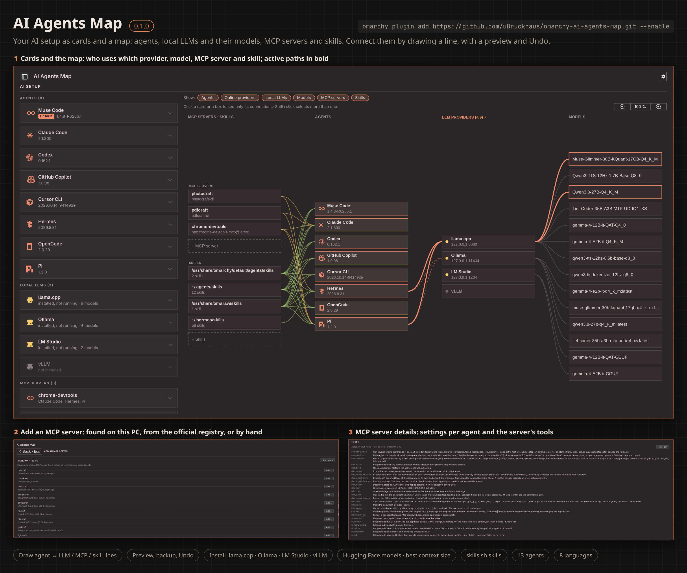
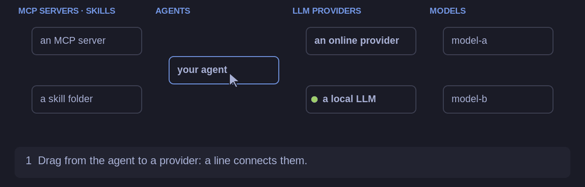

# AI Agents Map

An easy overview of the AI setup on this computer, and a way to change it by drawing: which coding
agents are installed, which LLMs they use (cloud services and local runtimes) and the models those
serve, which MCP servers and skills each agent has. For people new to it as much as for checking and
tidying your own setup.



Setting up by drawing (the animation in Help, drawn in your theme's colours):



## Install

```sh
omarchy plugin add https://github.com/uBruckhaus/omarchy-ai-agents-map.git --enable
```

A robot button appears in the bar. On the first open AI Agents Map asks whether to add itself to
Omarchy's app launcher (Super + Space); nothing is written there unless you say yes.
It is a normal app window: Hyprland tiles or floats it like any other, Alt+Tab and workspaces work,
and it stays open while you work in other windows. The bar button opens it, brings it to the front
(also from another workspace), or hides it when it is already in front. Closing the window hides it:
the program keeps running in the background and opens again at once. While an agent runs inside it,
closing (Super + Q) asks first: **Stop and close** (its local LLM then stops too and frees the
graphics card's memory) or **Keep running**. When AI Agents Map ends, the agents running in it end
with it.

Requires Python with PyGObject, GTK4 and libadwaita in an Omarchy/Hyprland session; all come with a
standard Omarchy install (libadwaita with Nautilus). Running agents inside the window (▶ on an agent's box, or **Start here** in its menu) needs VTE for GTK4
(`sudo pacman -S vte4`); **Start in terminal** opens it in a terminal window of its own. Installing local LLMs uses `curl` and `tar` (and `uv` for
vLLM); the MCP and skills search uses `curl`.

## Setup and the map

The header has **Setup** and **Map** on every page (the one in view highlighted), then a red **!**
when something needs fixing, **ⓘ** for the legend, **?** for Help (F1) and the gear for Settings
(Ctrl+,).

**Setup** has a card for every agent, local LLM, MCP server, skill folder and model, in sections
that fold with a click on their bar:

- **How things get onto your map**: a folded card at the top with five numbered steps (switch on or
  find what you use, install what is missing, sign in to an online agent, connect by drawing, what
  shows up by itself); **What you can do with this**: what the setup is good for (everyday help,
  coding, images, voice, research and writing), one tile each with the next step.
- **AI agents, Local LLMs**: every one the plugin knows. Installed ones have a blue frame and their
  version, the others **Install**. A click on an installed card opens its details.
- **MCP servers, Skills, Models**: a card for each one that is installed, and a card at the end of
  each section that adds one (**Add MCP server**, **Add skills**, **Add model**).
- **⋯** or a right-click on a card opens the same menu as the box on the map: update, sign in, start
  or stop, details, uninstall or remove, move a model. A yellow **↑ version** means an update is
  waiting, a red **!** an open problem there (hover it).
- A small **battery** on an online agent's card shows what is left of its limits (a session, a
  week): the tightest one counts, yellow at a quarter or less, red under a tenth; hover it for each
  limit and when it resets. On a running local LLM's card it is the GPU memory still free.
- The refresh symbol (F5) in the header looks again at what is installed, set up and signed in, and runs the checks of a start again (new apps, add-ons, updates, open problems).

**The map** shows only what is set up, across the whole width: MCP servers and skills ← agents →
LLM providers → models, under the **GPU** card (GPU memory and activity; it folds).

- Hover a box to light it and what it is joined to; the **pin** at its top right keeps that lit.
  Click selects (✓), Shift+click adds more, Esc clears. **Right-click** a box for everything its
  card offers. **▶** on an agent's box starts it in a terminal in this window.
- Each agent's active path (agent → provider in use → its model) is drawn bold; a **red dotted**
  line joins an agent to a provider it is set up for but does not use now. Online agents' boxes
  carry the same battery as their cards, running local LLMs' boxes the free GPU memory.
- The **Show** toggles leave whole categories out (remembered). In a narrow window (below about
  1300 px) the map picks them itself, said in a line beside the toggles: agents and providers while
  an agent runs, else providers and models; **Maximize for more room** in the header gives it the
  whole screen. **− 100 % +** (Ctrl+scroll, Ctrl+plus/minus/0) zooms.
- Until the first line is drawn, a card above the map shows how in three steps (**Watch how** plays
  the animation from Help); it goes for good after the first connection, or with ×.
- **Legend**: **ⓘ** in the header explains every dot, line and mark of the map, drawn as there.
- **Terminal tabs**: while agents have terminals here, a tab line above the map has a tab for each
  with a dot for working, running or ended; a click shows that terminal, × closes an ended one
  (Settings › **Terminal tabs above the map**, on by default).
- **Working now**: while an agent is working (herdr shows it working, its process uses the CPU, its
  session files were written in the last seconds, the session file it holds open is in the middle of
  a turn, or its local LLM is generating), light runs along
  its line to its provider and model (Settings › **Map animations**: agents and other programs, only
  agents, or off; off when the desktop turns animations off).
- **Usage statistics box** (new in 0.21.0): along a working agent's line to its provider, in the
  line's colour, how fast its latest reply came (tokens per second), its context size and how much of
  it is in use (yellow from 75 %, red over 90 %, like the batteries). Read from the agent's own
  session files, numbers only (Claude Code, Codex, Pi; the newest file of the last minute, its last
  256 KiB). Settings › **Usage statistics box**: on or off, what it shows, text size.
- **Subagents** (new in 0.22.0): while an agent works with subagents (Claude Code's Task/Agent tool,
  OpenCode's task tool), its box shows a small tree mark next to ⇅ (dim while it has only finished
  ones listed). A click opens its **Subagents** page: a map of its own, laid out like the big one,
  with the agent's card at the left and a card of its subagents at the right — each one's task, type,
  folder and "working" or "done … minutes ago", light on the lines to the working ones, finished ones
  dimmed. Settings › **Subagents**: how long finished ones stay (30 minutes by default) and how many at
  most (10); working ones are always shown.
- **Cost for API users** (new in 0.22.0): an agent paid per token (signed in with an API key, so it
  has no plan limits for a battery) shows on its box and card what its sessions active today cost at
  API prices, as "$3.40 today", refreshed every minute: green, yellow from 75 % of a day's limit, red
  over it. Settings › **Costs**: the currency (US dollar, or euro at the European Central Bank's daily
  rate), the day's limit (100 by default), **Yellow from** and **Red from** (the share used at which
  a cost or a battery turns yellow, 75 % by default, and red, 90 %; red always above yellow) and
  **Notify when red**. The prices (Anthropic, OpenAI, DeepSeek, xAI, Google,
  with the date they were taken) come with the plugin in `plugin_costs.py`; an estimate.
- **Agents using agents** (new in 0.22.0): when an agent started another one (the other's process
  runs under its own, for example Claude Code running `pi -p …` in its shell), an arrow runs along the
  left of the agents' card from the agent that uses the other to the one it uses, with light on it.
  An agent can use several others at once, each with an arrow of its own. While it is used, the
  agent it uses has its lines to its provider and on to its model in the arrow's colour too, with
  the light in that colour (new in 0.23.0).
- **Stop…** (new in 0.23.0): an agent with instances outside this window (a terminal window, the
  background) offers to stop one of them, picked from a list with where and when it was started.
- **In the background** (new in 0.23.0): for an instance that runs without a window (`claude -p …`
  from a script, Pi in another agent's shell), the console opens a terminal tab that shows what it
  writes, as it writes it (see Privacy).
- **Ask an agent which MCP server fits** (new in 0.23.0, Add MCP server › MCP registry): in your own
  words; the agent turns it into search words, the app searches the downloaded registry list with
  them, and the agent picks the servers that fit from what was found, each with why. No web search.
- **Ask an agent which model fits** (new in 0.23.0, Models page): in your own words; the agent
  chosen for AI checks looks on the web for models that fit your question and this PC; its suggestions
  (10 by default, **Suggestions** at the right of the agent line: 5 to 20) show in the result list as
  the Hugging Face models they were found as, each opening its page and download options.
- **Notify when red** (new in 0.23.0, Settings › Costs, on by default): a desktop notification once
  when an agent's limit or cost turns red, with its reset time.
- **Frames that follow the light** (new in 0.24.0): every box has the same thin grey frame. Hover a
  box, or click (or pin) one, and it and every box joined to it get a frame in the accent colour,
  as wide as a selected box's (a click's frames stay while the pointer is not over another box).
  An agent's symbols (traffic, console, battery or cost, stop, ▶) sit
  at the right edge of its box.
- **Folding cards** (new in 0.24.0): click a card's header (▾ at its right) to fold the card to its
  header (▸) and again to open it. The lines of a folded card's boxes end at its header (the arrows
  between agents hide while the agents' card is folded). Opening a card moves the cards you put
  around it out of its way.
- **Layout pin** (new in 0.24.0): the pin right of the zoom keeps the map's layout (where you put
  the cards, the order of the boxes, which cards are folded) after Refresh (F5) and a restart.
  Unpinned, as it starts, the map comes back in its default layout on every refresh and start.
- **Used from outside the map**: when a program that is not on the map (a plugin such as Video
  Trans, a chat app, a script) generates with a local LLM, the line from that LLM to the model is
  drawn bold in a colour of its own, light runs along it, and the model box says who uses it ("in use
  · Video Trans"). It shows while that program sent a request in the last 10 s and the GPU was
  generating.
- **Running now**: an agent with an open instance gets a green dot and "running" (or "2 running"),
  and the model box it runs with says "in use · <agent>": the model given with `--model` when it was
  started, else the one in its settings. Checked every 2 seconds from `/proc` (your own processes
  only).

### Open problems, updates and suggestions

A red **!** in the header appears when something needs fixing; its tooltip says how many. It opens
**Open problems**, one line each (an agent that is not signed in, a local LLM without models, a
connection that does not work, little free space for models) with a button to where it is fixed:
the agent's or local LLM's details, the map with that line lit, Setup, or Tidy up. The same problems
show as a red **!** on their cards. The check only reads what the window collected plus the
graphics card, memory and free disk space; nothing is changed, started or sent.

Below them, **Updates and suggestions** lists new programs or skills found on this PC (with **Add
MCP server…** / **Add skills…**), what is on this PC but not on the map (with **Setup**), and
**updates** for the installed agents and local LLMs. With only these and no problem, the **!** shows
in the accent colour. Updates are checked in the background when the window opens and at most every
6 hours (cached in `~/.cache/ai-agents-map/updates.json`, 0600), each the way it was installed, so
**Update** installs what was named:

- agents installed with mise (Claude Code, Codex, Copilot, Cursor CLI, Muse, OpenCode, …): one
  `mise outdated --json`; **Update** runs `mise upgrade <tool>` in a terminal window of its own
  (with `MISE_USE_VERSIONS_HOST=0`, so mise reads the tool's own releases: its version service can
  lag behind a release for hours; aqua still checks the SHA-256);
- Claude Code also by its own release channel (`autoUpdatesChannel` in `~/.claude/settings.json`,
  from the npm registry's dist-tags), like its "Update available!" message; installed with its own
  installer, **Update** runs `claude update`;
- local LLMs and agents AI Agents Map installed: their latest release; **Update…** opens the
  Update page (SHA-256 checked as on install);
- system packages are left to the system's updates.

Nothing is installed or run by the check itself (except `mise outdated`); an update starts only
with a click on **Update**. Pages opened from the map or from Setup (details, adding MCP servers or
skills, models, installing, connecting) open in place of the map; **Back** returns to where they
were opened from.

### Details pages

An agent's details (a click on its card, or right-click its box › **Details**) start with whether it
is ready (and if not, why) and whether it is running now or when it was last used. Below, every
category is a card that folds, with a one-line summary and badges:

- **Usage and tokens**: today's and the last 7 days' tokens and sessions, the plan, a chart of tokens
  per day, rate limits with reset times (from Omarchy's own usage data, refreshed when you open the
  page) and tokens by model.
- **API cost** / **API value** (new in 0.22.0): what its tokens cost at the providers' API prices —
  today, the last 7 and 30 days, and per model the split into input, output, cache read and cache
  write (tokens and amount); for an agent paid per token with its share of the day's limit, for one on
  a plan marked as covered by it. Local models cost nothing; Crush shows the cost it reports itself
  (it keeps no token counts that add up); for an agent that keeps no token counts on the PC (Cursor
  CLI, Antigravity, Muse) the card says the cost is not known.
- **Projects, last 30 days** (Claude Code, Codex, Pi, Oh My Pi, OpenCode, Hermes, DeepSeek Harness,
  Goose, Gemini CLI, OpenClaw): per project folder the working time, sessions, tokens, subagent runs,
  lines changed and what the tokens would cost at API prices, from each agent's own session files or
  database; no message text is read.
- **In herdr now**: when you run agents in [herdr](https://herdr.dev), each of the agent's herdr
  panes with its state (waiting for you, working, idle, done) and folder, read again every 4 seconds
  while the page is open; a click on one switches herdr to that pane and brings its terminal window
  to the front.
- **Health**: every check with a ✓, or what to do next (sign in with which command, which
  subscription or API key it needs and where to get one, install or start its local LLM, download a
  model, add MCP servers or skills, a connection that does not work).
- **Security settings**: what the agent may do without asking you, read from its own settings file —
  Claude Code (permission mode, sandbox, block bypass mode, allow/ask/deny rules), Codex (when it
  asks, sandbox, network in the sandbox, trusted folders), Copilot (permission mode, trusted
  folders), Cursor CLI (approval, sandbox, network, web search, allow/deny rules), Hermes (dangerous
  commands, hide secrets, where commands run), OpenCode (ask/allow/never for editing, commands, web
  pages, outside the project) and Pi (its tools; Pi never asks). Each setting opens to every choice
  with what it means and its risk; **Use…** shows the change (old → new, risk before and after, the
  lines of the file) and **Change** writes only that key, with a backup and Undo.
- **Risk management**: what the settings mean together, most serious first, with what lowers each
  risk (**Lower it…** opens the change); **What the words mean**: sandbox, approval, allow and deny
  rules, trusted folders, network, bypass, automatic review, prompt injection, MCP servers.
- **Configuration**: its settings, MCP servers, skills and settings folder.

A local LLM's details do the same: running, GPU memory and loaded models, models, connected agents,
what is missing, and who can reach it (only this PC on 127.0.0.1, or your whole network). An MCP
server's details show each agent's settings file, command or address (names only for environment
variables and headers) and, on request, the server's tools; **Remove** takes it from every agent. A
skill folder's details list every skill with its description and how each agent gets the folder.

## Information

**ⓘ Information** (beside Help) links to the author's other Omarchy plugins; a card opens the
plugin's page in the Omarchy Plugin Marketplace in your browser.

## Connecting by drawing

Every change below shows exactly which lines of which file change before anything is written, keeps
the old file in `~/.local/state/ai-agents-map/backups/`, and can be undone from the bar that follows.

- **Agent ↔ local LLM**: press on an agent and drag to a local LLM (or back). Pick the model and
  whether the agent uses it right away. Click a line to select it: drag its end to another local LLM
  to move the connection, or onto empty space to remove it. With an agent selected, a click on a
  model of a local LLM it is connected to makes that model the agent's model. Supported: Hermes
  (`~/.hermes/config.yaml`), Pi (`~/.pi/agent/`), OpenCode (`~/.config/opencode/opencode.json`) and
  OpenClaw (`~/.openclaw/openclaw.json`; a file it can no longer read safely is left alone, and
  `openclaw configure` is the way then).
- **Model lines**: a selected box shows an orange hook at the end of each line that can be moved.
  Drag a local LLM's line to a model onto another model of the same local LLM: every agent that uses
  it switches (one Undo for all); into empty space, they are disconnected from it. A model that is
  only loaded (no agent uses it) is unloaded when its line goes into empty space, or the other one
  is loaded instead. Nothing moves while a running agent, or a program outside the map, uses the
  model. Draw a line from a local LLM to one of its models to load it, and tick agents (none at
  first) that should get it.
- **Online models**: Claude Code's and Codex's models show under their cloud. Drag an agent's model
  line to another one to switch (its own setting: `model` in `~/.claude/settings.json`, `model = "…"`
  in `~/.codex/config.toml`; backup and Undo), counted from the agent's next start. A line drawn from
  an agent to its online provider starts the agent's own sign-in in a terminal; dragging that line
  into empty space asks first, then runs its own sign-out (`claude auth logout`, `codex logout`).
- **A provider that is gone**: an agent still set to use a local LLM it has no provider for gets a
  red line with **Repair** (connect it again, with preview) and **Remove** (clear that setting).
- **Agent ↔ MCP server**: the server's settings are copied from an agent (or the list) that has it
  into the other agent's own format, for Claude Code, Codex, Copilot, Crush, Cursor, Gemini, Grok,
  Hermes, Muse, Oh My Pi, OpenClaw, OpenCode and Pi. Claude Code's servers are
  written into `~/.claude.json` directly (never with `claude mcp add-json`), so no key from
  env, headers, args or the URL ever appears in a command line.
- **Agent ↔ skill folder**: Pi and Hermes get the folder in their settings list; every other agent
  gets one link per skill in its own skills folder. A folder an agent reads by itself (most read
  `~/.agents/skills`) cannot be taken from that one agent; the page says so.
- **Local LLMs**: right-click to **Start** or **Stop** one or to start it at login (its user
  service, or `lms server` for LM Studio), or **Free GPU memory**: its models are unloaded, it keeps
  running and loads one again when asked (vLLM cannot unload, so it is stopped). A local LLM that
  holds GPU memory gets a stop button on its box that asks first: **Free GPU memory** or **Stop**
  (for LM Studio **Stop server**: the app stays open with its models). LM Studio open without its
  server says *server off* (yellow dot) and offers **Start server**; a model a local LLM has loaded
  but no agent uses is joined to it by a solid light line.

### When a connection fails

Right after a drawn connection is written, AI Agents Map checks whether it will work:
- **Local LLM:** the agent's settings have the provider. The LLM is installed, lists the model, and
  is running or will be started with the agent. When it runs, its port is yours and its API offers
  the model. The model's context is at least 16k tokens.
- **MCP server:** the agent's settings have it, and it answers (initialize and tools/list, as
  **Test** does: a local server is started for this and stopped again).
- **Skills:** the folder is there with skills in it, and the agent's links to them are not broken.

A connection that could not be written at all, or that fails its check, stays on the map as a
**dotted red line** with a **!** (a **dotted yellow** one has warnings only). Click the line or its
**!** for the hints:
- **Test again** checks once more; when it passes, the line is normal again.
- For a connection that was never written, **Try again…** opens the connect page.
- **Remove connection** removes it as usual (for one that was never written, only the line goes).

The hints stay with the line until you remove it by hand, also across restarts
(`~/.config/omarchy/ai-agents-map/failed-links.json`).

## Local LLMs start and stop with their agents

Connect an agent to a local LLM once, close AI Agents Map and just start the agent: its local LLMs
start with it, and when the last agent using one closes, that LLM stops, so its GPU memory is free
again. This works with the window closed and after a reboot.

- A small watcher does it, the user service `ai-agents-map-providers.service`
  (`provider_watch.py`). It is set up when the first agent is connected to a local LLM and removed
  when the last connection goes or the setting **Start local LLMs with their agents** is switched off.
- Once a second it looks at this user's processes (`/proc` only). A connected agent starts →
  `systemctl --user start` the service of the local LLM it uses now, the one its current model is
  on (`lms server start` for LM Studio); other LLMs it is only set up for stay off. Choosing
  another model on the map while the agent runs starts that LLM within a second. The last one closes
  → after 5 s the LLM is stopped, unless another program still has a connection open to it.
- Background servers of agents (OpenCode's `opencode serve --service`, which runs all the time) do
  not count as the agent being open, and their idle connections do not keep an LLM running.
- If `lms server start` had to start LM Studio itself (a hidden `lm-studio --run-as-service`), that
  one is ended too, with its children and its engines (`~/.lmstudio/extensions/backends/…`, which
  hold the loaded model and outlive the app otherwise): the engines with SIGTERM, then the app's
  processes all at once with SIGKILL and the AppImage process last, because LM Studio runs from the
  AppImage's mount and ending it piece by piece makes the rest crash. An LM Studio window you opened
  is left alone.
- KoboldCpp is the exception: it takes about 6 s to start, longer than some agents wait for their
  first answer, and costs no video memory while no model is loaded. So it starts at login (its
  install page preselects that) and the watcher only **unloads** its model when the last agent
  closes (`POST /api/admin/reload_config` with `unload_model`, after checking that the listening
  port belongs to you).
- When the plugin is updated, the watcher notices its own file changed and restarts with the new
  version (what agents still need keeps running).
- What it still has to stop is kept in `~/.local/state/ai-agents-map/provider-watch.json`, so a
  restart (reboot, plugin update) or removing an LLM's last connection never leaves it running.

Above the map, **GPU memory** (in use, free, split into local LLMs, desktop & apps and free) and
**GPU activity** (load, temperature, power; green while a model is generating) show the same as LLM
Monitor. Each local LLM's box shows how much GPU memory it holds, and loaded models get a green dot.

## Adding MCP servers and skills

The Add pages share one layout: a short explanation of what MCP servers or skills are and how they
are used, tabs at the top (the choice is kept per page), and on the web side **Search on**: the default site, or
a site you add with **Add a site…** (kept in the settings until you remove it with the bin):

- models: Hugging Face, or a site with the same API (a mirror such as `https://hf-mirror.com`);
- MCP servers: the official MCP registry, or another registry with its API (`…/v0/servers`);
- skills: skills.sh, a site with its API, or a GitHub repository with skills
  (`https://github.com/owner/repo`: lists its folders with a `SKILL.md`; an empty search lists all).

Only https addresses without user, query or `#`; a site you added is asked only when you search.

**Add MCP server** (the card at the end of Setup's MCP servers) opens a page laid out like the models page: a list
on the left, the chosen server's page on the right. The page says who made it and how much that is
checked, what it does (with things to ask an agent once it has it), how it runs (each way as a row:
a program through npx, uvx or Docker on this PC, or a web service, with what that means and whether
the program it needs is installed), and what it needs (a folder, an API key, with a link to where
you get the key). Below it, **Set it up**: the fields it needs, the agents that get it, its name,
**Command and settings** (folded), **Test** (asks the server for its tools) and **Add** (writes all
ticked agents at once: one preview, one Undo). No agent is ticked unless you selected one.

- **Recommended**: the reference servers of the MCP project (github.com/modelcontextprotocol/servers:
  Filesystem, Fetch, Git, Memory, Sequential Thinking, Time, Everything) and the official servers of
  well-known makers (GitHub, Playwright, Chrome DevTools, Brave Search, Context7), grouped by what
  they are for. Each package is pinned to its newest version on npm or PyPI when you open it
  (`npx -y pkg@1.2.3`, `uvx pkg==1.2.3`); offline it stays unpinned.
- **On this PC**: programs that offer an MCP server, found by reading the files (nothing is
  started): your own programs (`~/.local/bin`, `~/bin`, extracted apps in `~/Applications`, `/opt`)
  and anything on PATH with "mcp" in its name. A program counts when its own usage text has an
  `mcp` mode (`x-cli mcp [--automation-read-root DIR]`) or it holds the MCP protocol's words; read
  and write folders get a folder that fits the app. AppImages are never run by this scan: **Look
  inside…** unpacks each one's `usr/bin` into a temporary folder, reads it and removes it again.
  Adding a server that lives in an AppImage unpacks the AppImage into
  `~/Applications/<app>-<version>/` first. Servers already set up are not offered again.
  **App updates**: when a newer version of an app turns up (`gridcraft-0.7.0-….AppImage` next to
  `~/Applications/gridcraft-0.6.1/`), a note names it when the window opens; nothing in it runs
  until you click **Look inside…** (a newer file name is no proof of a genuine update). Once looked
  into, only the newest is listed. While agents,
  the list of MCP servers or a link in `~/.local/bin` still start the old version, it shows as
  **Update…**: one preview unpacks the new version, points every one of them at it and moves the
  old folder into the backup (deleted after 7 days; Undo within that time brings everything back).
  **Check for updates** (On this PC) does all of it at once after your click: it looks inside the
  new versions, offers every update in one preview with one backup and one Undo, and then tests
  each updated server (a note names any that does not answer).
- **MCP registry**: a search of the official MCP registry (`registry.modelcontextprotocol.io`), 20
  results at a time, paged in one line under the list: **‹ Previous 20** · 21 – 40 / 200 ·
  **Next 20 ›** (the total from the saved list; "/ 40+" when the registry itself is asked, as its
  API only says whether there are more). Its own search takes 10–30 s, so its list of
  servers is saved in the background when the app starts (Settings › Keep the MCP server list, on by
  default; at most every 12 hours, after the first time only what changed; nothing without a
  connection) in `~/.cache/ai-agents-map/mcp-registry.json` (only for you) and searched there; until
  it is there, the registry itself is searched. Each result names its publisher as the registry checked it
  (a GitHub account for `io.github.<user>/…`, a domain for `com.example/…`). npm packages run with
  `npx`, PyPI packages with `uvx`, images with `docker` (of the image's own `docker run`
  arguments only `-e NAME=value`, passed as `-e NAME` with the value in docker's environment),
  remote servers by their https address; the variables a server needs (API keys, folders, also
  inside a value such as `Bearer {api_key}`) become fields, and optional ones left empty are left
  out. A secret field is never put on a command line, where other users of the PC could read it:
  a server that would need that has to be set up by hand.
- **By hand**: a command line, or an address with headers.

**+ Skills** opens the same kind of page: skill folders that apps brought along and no agent reads
yet (`/usr/share`, `/opt`, `~/Applications`, `~/.local/share`, global npm packages, Claude plugins),
or a search of the skills.sh directory. A skill from the web is fetched from its GitHub repository
(file list from `api.github.com`, files from `raw.githubusercontent.com`) into a folder of your
choice, by default `~/.agents/skills`. Skills can hold scripts an agent may run later; the page
shows the repository and lists the scripts before anything is fetched.

MCP servers stay listed (`~/.config/omarchy/ai-agents-map/mcp-servers.json`, readable only by
you) when no agent uses them any more, so a line can connect them again. On every open,
AI Agents Map looks for new programs and skill folders in the background; new ones show as
"· N new" on the **+** boxes.

### New agents

When Omarchy offers an agent this plugin does not know yet and it is installed, AI Agents Map asks
an installed agent once to find out on the web where it keeps skills and MCP servers: Claude Code
(`claude -p` with only its WebSearch and WebFetch tools: no shell, no file access, no MCP servers)
or else Codex (`codex --search exec` in its read-only sandbox). The prompt holds only the agent's
name, command and version. The answer is checked before use (folders only under your home folder,
never `~/.ssh`, `~/.gnupg` or credential files; JSON, TOML or YAML only; a fixed list of field
names; nothing in it is ever run) and kept in `~/.config/omarchy/ai-agents-map/agents/`. Settings →
**Look up new agents** switches this off; right-click the agent on the map to look it up again.

### Smart Check and Daily AI checks

While Claude Code or Codex is installed, the header has a **Smart Check** button (two sparkles). Its
page shows what an installed agent did and found for this PC, in cards, under an **At your own
risk** note (an agent's findings, answers and changes can be wrong, incomplete or out of date; read
what it proposes before agreeing to a step and keep backups; it uses your tokens; no warranty for what
an agent does). The same note heads Settings › **AI features**.

- **PC setup summary**: **Check now** gives the agent a short description of the setup (agents and
  their versions, models and providers, local LLMs, MCP servers and their versions, number of
  skills, the GPU and memory, and the setup check's own findings; never keys, settings values,
  environment variables or headers). It answers with a summary and findings (problems, tips, what
  is good); each problem or tip has **Fix it with Claude Code…**, which opens the agent in a
  terminal tab with a prompt of ours that names the finding and asks it to ask before each step
  (and to leave moving MCP servers to a new version to AI Agents Map's Update, which changes every
  agent's settings in its own format at once).
- **Updates found**: newer versions of your local MCP servers (apps unpacked in `~/Applications`,
  npm or PyPI packages pinned to a version), each with **Release page** and **Do it with Claude
  Code…** (the agent only downloads the new AppImage into `~/Applications`; AI Agents Map then
  unpacks it and moves the agents over, with Undo). **Check now** asks at once. Once the new version
  is on this PC (unpacked or as its AppImage), the line offers **Use it…** instead of a second
  download: the map's Update preview, one backup, Undo, a test of each server. The card also lists
  the map's own finds (as on Setup): a newer version here that an agent still does not start. A
  server drops off once all its agents start the new version. After an action started here (an
  update, a task's terminal tab), Back returns to Smart Check.
- **Token statistics**: tokens today and in 30 days, their value at API prices and whether a
  subscription covers them (the agent's plan, e.g. Max 5x: it counts against the plan's limits, no
  extra charge; with its API key variable set, the key is charged), per agent, per plugin and per day.
- One card per kind of task (MCP server updates, setup analysis, looking up new agents, fixes):
  runs, failures, results and tokens.

Settings → **Daily AI checks** (off by default) lets the agent look for MCP server updates once a
day; **Agent for AI checks** picks Claude Code or Codex for these look-ups, for looking up new
agents and for "Do it with …". A failed install or update in a terminal tab offers **Fix it with
…** too.

### Skills for an MCP server

A skill written for an MCP server (its folder has the server's name, or its SKILL.md calls the
server's tools as `mcp__<server>`) is listed on that server's page with whether it still matches the
server's tools. After an app update moved its server to a new version, the note says which skills
may need an update. **Update skill…** asks the server for its tools, then Claude Code rewrites the
SKILL.md to match them (`claude -p` with no tools at all: `--tools ""`, no MCP servers, no session
kept; else Codex `codex exec` in its read-only sandbox). The old skill and the tool list go in on
stdin; the answer must be a SKILL.md with the same name (size-capped) and is only shown as a preview,
written after your OK with a backup and Undo. Only your own SKILL.md files under your home folder are
offered; a skill an app installed elsewhere is updated with the app.

## Installing local LLMs

Use a local LLM's card on Setup (once installed, also its right-click menu on the map). Not installed (grey card): **Install…** downloads the official release
into a program folder you choose (one folder per version, a `current` link, the command in
`~/.local/bin`) and sets up a user service, so no password is needed; you also choose the model
folder (the one your other local LLMs use is suggested) and whether it starts at login. Installed
this way: **Update…** (new version folder, the previous one is kept as a fallback), **Model folder…**
(change it later) and **Uninstall…** (program, command, service and settings; never the models).
Installs made by hand are shown but never changed. Every download must match the SHA-256 checksum
its GitHub release lists before it is unpacked or run; a release without one, or a file that does
not match, is not installed.

- **Ollama**: the official release (with ROCm for AMD cards), user service `ollama`.
- **llama.cpp**: the official build of your choice (Vulkan, preselected for AMD unless ROCm is
  installed; ROCm; CUDA; CPU), run as a model router (`llama-server` service: every GGUF in the model
  folder, one loaded at a time, per-model settings in `~/.config/llama.cpp/models.ini`).
- **LM Studio**: not installed or updated from here, since LM Studio publishes no checksum or
  signature for its download; get it from lmstudio.ai. A copy installed by an earlier version of
  AI Agents Map can still be uninstalled and its model folder changed. Its server runs with `lms server`.
- **vLLM**: for NVIDIA cards, in its own Python environment (uv); on AMD cards vLLM needs ROCm
  containers, so it is not offered there.
- **Jan**: its AppImage, unpacked (no FUSE needed), with a desktop entry (`jan-desktop`). For agents,
  Jan's own engine (`jan-llama-worker`, a llama.cpp router) runs without the app as the user service
  `jan` on 127.0.0.1:6767, with the models of Jan's data folder (`~/.local/share/Jan/data` unless
  you choose another one when installing) and Jan's per-model settings
  (`llamacpp/router.preset.ini`). Models are added in the Jan app; its own API server (port 1337)
  counts as Jan too. The engine ends when its input closes, so the service keeps it open
  (`sleep infinity |`); systemd stops both.
- **KoboldCpp**: the official single-file Linux build (Vulkan for AMD and Intel, CUDA for NVIDIA,
  or CPU) as a model router (`koboldcpp` service: `--admin --routermode`). Every GGUF in the model
  folder gets a `.kcpps` in `~/.config/koboldcpp/models` with its context (the best fit for your
  card) and the GPU choice; those file names are the model ids agents ask for
  (`gemma-4-E2B-it-Q4_K_M.kcpps`), loaded on the first request. New models get theirs when the
  window opens or after a download; uninstalling removes the ones AI Agents Map made.

### Agents AI Agents Map installs

Three agents Omarchy's menu does not offer are installed the same way (their card on Setup, ⋯ →
**Install…**, **Update…**, **Uninstall…**; a version folder, the command in `~/.local/bin`):

- **DeepSeek Harness** (`dsh`, developer preview): from npm with install scripts switched off
  (`npm install --ignore-scripts`; needs Node.js). Lines to local LLMs go into its web profile's
  patch `~/.dsh/profiles/web/cordis.patch.yml`, the file its own Settings › Models writes: a
  provider per local LLM (OpenAI Chat Completions, with a placeholder `Authorization: Bearer local`
  header because dsh refuses a request without a key) and, for "Use it now", its default model.
  Only those entries and the MCP servers drawn to it are rewritten; everything else in the file
  stays as written. dsh reads `~/.agents/skills` and `~/.dsh/skills` by itself. Only local LLMs
  are set up; DeepSeek's own API (a key) is set up in dsh. Its web server (`dsh web`) counts as
  the agent being open.
- **Goose** (`goose`, Agentic AI Foundation, formerly Block; new in 0.22.0): its GitHub release through
  mise (`github:aaif-goose/goose`), in a terminal you watch — not the `download_cli.sh` script its docs
  pipe into a shell. Its settings are `~/.config/goose/config.yaml` (provider and model, read for its
  card; MCP servers drawn to it go into its `extensions` as `stdio` or `streamable_http` entries, as
  one planned change with backup and Undo); API keys stay in the system keyring or its
  `secrets.yaml` (only whether that file is there is checked). **Configure…** runs `goose configure`.
- **Antigravity CLI** (`agy`, Google): the release Google's own install script would take, from
  its release manifest (version, a tarball on `storage.googleapis.com` and its SHA-512); only that
  bucket and a full SHA-512 are accepted, and the tarball is checked before anything is unpacked.
  Google's script itself is not run (its last step only adds `~/.local/bin` to shell profiles).
- **LM Studio Bionic**: not installed or updated from here (no checksum or signature, as LM Studio);
  get it from lmstudio.ai. A copy installed by an earlier version can still be uninstalled. Bionic runs local models
  itself with LM Studio's engine and models, so it is always linked to LM Studio and cannot be
  connected to another local LLM; the watcher never starts LM Studio for it, and stopping a hidden
  LM Studio never touches Bionic's processes. Its global skills live in `~/.lmstudio/skills`
  (shared with LM Studio); its MCP servers are set up in Bionic (Settings › Connected apps).

## Downloading models

Right-click an installed local LLM → **Models…** (or the **Add model** card on Setup). The page is
laid out as LM Studio's model search: a list on the left, the chosen model's page on the right, in
three tabs.

- **Get from Hugging Face**: the trending GGUF chat models, or a search (Hugging Face, or a site you
  added with the same API). Each result shows its author, size, downloads, likes, age and what it
  can do (Vision, Tools, Reasoning, MTP: from its task, tags and chat template, only read). The
  model's page shows its numbers, license, parameters (and active parameters for a mixture of
  experts), architecture, context, base model and its model card as plain text; **What the name
  means** explains the parts of its name (35B-A3B, Q4_K_M, IQ4_XS, UD, MTP, QAT, …). **Download
  options** lists every size with how it fits: in the graphics card, partly in system memory
  (works, slower) or likely too large; the one that fits best is chosen, and **Download** gets it
  into the model folder, with progress (Stop download stops it). LM Studio gets the folder layout
  it expects; a llama.cpp model folder that only holds links (a router folder) gets the file next
  to the originals and a link.
- **Installed**: each model with its size, file, context (now, best for your card, trained for;
  **Set context**) and what its name means. **Remove** asks first and moves the model's files to
  the desktop's trash (restorable); a model that is only a link loses only the link, and it says
  when another local LLM reads the same file through a link. Ollama removes its own models (it has
  no trash), after the same check that the port belongs to you.
- **On this PC**: GGUF files the local LLM does not read yet (the models folder, the other local
  LLMs' folders, `~/Downloads`, `~/Models`); **Add** makes one its model without a second copy (a
  hard link on the same disk, else a symbolic one; LM Studio gets it as `local/<name>/` with its
  vision projector; Ollama imports it with `ollama create`, which keeps its own copy).

For Ollama there is also a field for library names (qwen3:8b); a Hugging Face model is pulled as
hf.co/<repo>:<size>, and Ollama is started for it if it is not running. Before anything is sent to
Ollama on 127.0.0.1, AI Agents Map checks that the listening port belongs to you.

Downloads and installs run in the background: they keep going when you leave the page and show
in a strip at the top of the main page (progress, Stop). A broken connection is tried again after
5 s … 2 min and the download resumes where it stopped. A download or install that was still running
when AI Agents Map ended (closed, crashed, logged out) is listed as interrupted, with **Continue**
or **Discard**; it is kept in `~/.local/state/ai-agents-map/jobs.json` (0600; what to download,
never credentials). **Continue** asks the release again and uses its files and checksums, not the
saved ones; files already downloaded are kept only when their SHA-256 matches.

### Moving and deleting a model on the map

Right-click a model of llama.cpp, KoboldCpp or LM Studio → **Move to…** and pick another of these
local LLMs, or drag the model box onto that local LLM's folder (the folders it may go to are
framed). First it says what happens: how much moves, whether the folder is on another disk (then
the files are copied and the originals removed once the copy is complete) and which agent uses the
model. Only your own regular files inside the model folder move, never a link, and nothing at the
target is overwritten: on one disk the file gets a hard link at the new place before the old name
goes, a copy is written to a new `.part` file and linked into place, and a name that already exists
there stops the move. Undo, in the bar that follows, moves the files back. **Delete…** (at the
bottom of the menu, after a line) asks first and moves the files to the desktop's trash, as
**Remove** on the Installed tab does.

### One models folder, and Reorganize models

Settings › **Models folder** (type it or **Choose…**) is one folder for every local LLM's models;
**Reorganize models…** opens a preview of what would change, and nothing changes until you press
**Reorganize**:

- every GGUF a local LLM knows goes to `<folder>/<publisher>/<model>/` (LM Studio's layout), or
  `local/<name>/` for a file without a publisher; Ollama's store goes to `ollama/`; llama.cpp and
  KoboldCpp installed by AI Agents Map get `llama.cpp/`, a folder of links to every model;
- the local LLMs are pointed there: LM Studio's `downloadsFolder`, and the model folder of those
  AI Agents Map installed (they restart if they run; Ollama is stopped while its store moves). A
  local LLM installed by hand keeps its folder: its links follow the moved files, and a file moved
  out of its folder leaves a link behind;
- **Keep old paths working** (on by default) leaves a link at every old place, for scripts and
  programs that use a model's old path;
- on one disk a move is a rename (instant); to another disk it is a copy with progress, the
  original removed once the copy is complete (refused without enough free space);
- every step is written to `~/.local/state/ai-agents-map/reorganize.json` (0600) first:
  **Undo the last reorganize** puts files, links and settings back.

### Model folders on Setup

Setup shows the models as the map groups them: one card for the online models and one per local
LLM's model folder, titled with the folder and, in brackets, who serves its models.
- **Add folder…** adds one more folder to look in (Settings `model_folders`); nothing is moved.
- **Change folder…** moves the folder's models to another folder after a question that lists what
  changes: files are moved (a hard link on the same disk, else a checked copy) with Undo; links in
  other local LLMs' model folders that led there are replaced (only links of your own, through a
  fresh random name); `~/.config/llama.cpp/models.ini` is rewritten where it names a moved file (a
  copy kept in `~/.local/state/ai-agents-map/backups/` first, written to a new private temporary
  file and renamed); a local LLM whose own model folder it was is pointed there and restarted if it
  runs.

Loading and unloading from the map (a line drawn from a local LLM to its model, or a loaded model's
line moved) asks only your own server (its listening port must belong to your account): llama.cpp
and Jan `POST /models/load` / `/models/unload`, Ollama `POST /api/generate` with `keep_alive`, LM
Studio `lms load -- <model>` / `lms unload -- <model>` (a model name is one plain word, never an
option). A local LLM that is not running is started first (`systemctl --user start` of its user
service, or `lms server start`).

### Context size

Each installed model shows its context now and the best one for your graphics card ("now 96k ·
best 92k"), calculated from the model file's header: its size, and how much video memory every token
of context takes (KV heads × key and value size × the cache type: f16, q8_0, q4_0). Sliding-window
layers (Gemma) only keep their window and recurrent layers nothing, so those models get much more.
The header is read as untrusted input: a file that claims more than 4096 layers, long per-layer
lists or deeply nested values is skipped (default context) instead of being calculated.
**Set** writes it: for llama.cpp `ctx-size` in the model's section of `~/.config/llama.cpp/models.ini`
(backup and Undo, restart llama.cpp for it to take effect), for Ollama the model's `num_ctx`, for
LM Studio `llm.load.contextLength` in the model's own defaults file
`~/.lmstudio/.internal/user-concrete-model-default-config/<model>.json` (what LM Studio writes when
you change it in its model settings; backup and Undo; used the next time LM Studio loads the model).
For Jan, `ctx-size` in the model's section of Jan's `router.preset.ini` and `ctx_size` in its
`model.yml` (so the Jan app keeps it; backup and Undo; restart Jan's service for it to take
effect); for KoboldCpp, `contextsize` in the model's `.kcpps` (backup and Undo; used the next time
it loads the model).
LM Studio's models are listed by the names its server answers to (`gemma-4-12b-it-qat`), read from
its model index, so agents connected to it ask for a model LM Studio knows. LM Studio loads a model
with 8192 tokens unless told otherwise, too few for an agent's prompt: connecting an agent to an LM
Studio model whose context is not set yet sets the best one in the same step (it is in the preview,
the backup and Undo), and the agent is told the same context. A context you set yourself is kept.

## Privacy and capabilities

- AI Agents Map itself never runs as root and never sees a password. The one exception to "no
  administrator rights" is installing an agent that comes as a system package, on **Install** only,
  after a dialog that shows the exact commands: Omarchy's own installers
  (`omarchy-install-hermes-cli --now`, `omarchy-install-openclaw-cli --now`) or
  `pacman -S --needed <package>` / `pacman -R <package>` through `sudo` (package names checked
  against a strict pattern), run in a terminal window you watch (or a terminal tab in the window),
  where the password is asked. Every program it starts is run as an argv list without a shell (the
  terminal's command line is built with every word quoted), and every program's output and every
  web answer is read with a size limit and one overall deadline.
- **Agents are described as data**: `adapters/<command>.toml` (where each agent keeps its settings,
  sessions, MCP servers and skills, how it is installed and signed in), plus a small
  `adapters/<command>.py` for five agents whose facts a file cannot say (Hermes and OpenCode read
  their own session databases read-only; Pi, DeepSeek Harness and OpenClaw their own settings).
  These come with the plugin; nothing is downloaded or loaded from elsewhere.
- **Reads** (to draw the setup): the agents' settings files, mise's install folders, the pacman
  database, user services (`~/.config/systemd/user`), model folders and this user's own processes
  (`/proc`, own UID only, including their GPU memory from DRM fdinfo), LM Studio's model index
  (`~/.lmstudio/.internal/model-index-cache.json`), the GPU's sysfs values
  (memory, load, temperature, power) and `/proc/net/tcp` (who listens on or is connected to a local
  LLM's port). From settings it takes names, model ids, folders and addresses; it never
  opens credential files (`auth.json`, `.credentials.json`). MCP server entries are read whole so
  they can be copied to another agent; their environment and header values are never shown.
- **Used from outside the map** reads, every 2 s while the window is open and for 1.5 s of that
  (100 ms apart, since a request holds its connection for a moment only), while the GPU is busy
  (a local LLM that answers keeps it busy; with a model loaded outside the GPU's memory, or no busy
  reading from sysfs, always), `/proc/net/tcp` and `tcp6` (the connections to a running local LLM's port that are established and yours, by their
  uid column; at most 8 MiB each), then `/proc/<pid>/fd` of your own processes to find which one
  holds such a connection, and that process's command line (and its parents' while they are your
  own helpers such as `sh`, `python3` or `curl`) to name it: a plugin by the `name` in its
  `manifest.json` (a plain plugin id only), an agent by its name, else the program's name. Nothing
  of what they send is read. AI Agents Map itself and LLM Monitor (status reads only) are left out.
  At most 16 names per local LLM, each forgotten 30 s after its last request; shown as plain text.
- **ⓘ Information** reads the marketplace catalog
  (`raw.githubusercontent.com/omacom/omarchy-plugin-marketplace/main/site/catalog.json`) only when
  the page opens, at most once an hour and only when it changed (its ETag; at most 40 MB), keeps
  only the author's own entries in `~/.cache/ai-agents-map/plugin-catalog.json` and shows them as
  plain text; without the network the cached or built-in list. A card opens a fixed
  `https://plugins.omarchy.org/plugin.html?id=…` address in your browser on a click.
- **Configure…** (right-click an agent's or local LLM's box) runs that program's own setup command
  in a terminal tab of the window: what its adapter names (`hermes setup`, `omp setup`,
  `ollama launch`, …), else `<program> --help`; an argv list without a shell that starts with the
  program's own name and holds plain words only (`harnesses.configure_ok`); LM Studio opens its own
  window. When the tab ends, the map reads the settings again and a running local LLM is offered a
  restart.
- **Network traffic (⇅)**: while the window is open, every 3 s `ss -tinpeHn` lists the TCP
  connections of your own processes with their byte counters; the bytes are added to the agent whose
  process (or a process it started: its MCP servers, its tools) owns the connection, per destination
  (known API hosts, looked up every 10 minutes; a local LLM; the local network; others) and per
  program. Nothing of what is sent is read; five minutes of history, in memory only; UDP is not
  counted.
- **Models at once**: when agents use different models of one local LLM, the number of models it
  keeps loaded is set where AI Agents Map installed it (llama.cpp `LLAMA_ARG_MODELS_MAX` in its env
  file, and `--models-max` removed from a service file it wrote itself; Ollama
  `OLLAMA_MAX_LOADED_MODELS` in its env file), with a preview, a backup and Undo like every other
  settings change; a number set in your own start script is left alone (a note says where). Before
  an agent starts, its model's size is compared with the free GPU memory; when it does not fit, you
  choose: start anyway, **Free GPU memory** first (other local LLMs unload their models through
  their own API, only on a listener of your own), or cancel.
- **LM Studio without its server**: while the LM Studio app runs but nothing of yours listens on its
  port, `lms ps --json` is read (at most every 20 s, 64 KiB, 5 s) to mark the loaded model.
- **Healthy & Security check** reads only the security keys of the agents' settings files named in
  the card (never credential files). **Disk space** walks the agents' program and data folders and
  the local LLMs' program, data and model folders with `lstat` only (no file is opened, links are
  not followed), at most 400 000 entries per folder and 60 s in all, plus `statvfs` of their disks.
- **Working now** reads, every 2 s while the window is open, the CPU time of the running agents'
  own processes (`/proc/<pid>/stat`, your own UID only), the modification times of their session
  files, and of a session file a running agent holds open (`/proc/<pid>/fd`, a `.jsonl` file of your
  own) its last 64 KiB for the turn markers `task_started`, `task_complete` and `turn_aborted` only
  (Codex writes them; whether a turn has begun and not ended). Nothing else of those files is kept.
  When Codex's `config.toml` names no model, the model of its last turn comes from the `model` key
  of the `turn_context` lines in its newest session file (`~/.codex/sessions/<year>/<month>/<day>/`,
  the last 256 KiB, else the first 64 KiB).
- **Subagents** reads, every 2 s while the window is open: for each running Claude Code instance its
  working folder (`/proc/<pid>/cwd`, your own processes only) to find its project folder in
  `~/.claude/projects`, and there the session folders' `subagents/`: each subagent's `.meta.json` (its
  type and the one-line description of its task, at most 16 KiB) and the modification time of its
  transcript; of a transcript written in the last minute, its last 256 KiB for the names of the tools
  called only (the hand-back that ends a subagent, never what it says). Your own regular files only,
  no links, at most 2 000 sessions per project folder and 40 subagents per agent. For OpenCode, the
  sessions with a parent session in its database (`~/.local/share/opencode/opencode.db`, read-only:
  title, agent type, folder and times). Finished ones are kept for Settings › Subagents' time only.
- **Cost for API users** and the **API cost** card: whether an agent is paid per token comes from
  whether one of its API-key variables is set (its name only, never its value), whether it signs in
  with API keys only and its credential file is there (DeepSeek Harness, Crush: never opened), or
  whether Omarchy's usage record names no plan. The cost is computed from token counts at the prices
  in `plugin_costs.py` (shipped with the plugin), at most once a minute while the window is open and
  when a details page opens. The token counts are read, numbers, times, model names and folders only
  (never what was said), from each agent's own files — your own regular files or databases, never
  through a link, opened read-only, the last 30 days, at most 2000 files of 64 MiB each (zstd files
  also at most 64 MiB once unpacked), lines over 8 MiB skipped:
  Claude Code `~/.claude/projects/*/*.jsonl`; Codex `~/.codex/sessions/*/*/*/rollout-*.jsonl`; Pi
  `~/.pi/agent/sessions/*/*.jsonl`; DeepSeek Harness `~/.dsh/sessions/*/session-*/session.v4.jsonl.zstd`;
  Oh My Pi `~/.omp/agent/agent.db` (table `client_usage`); Goose
  `~/.local/share/goose/sessions/sessions.db` (table `sessions`, its accumulated token columns and
  model); Gemini CLI `~/.gemini/tmp/*/chats/`; OpenClaw `~/.openclaw/agents/*/agent/openclaw-agent.sqlite`
  (table `transcript_events`) and `~/.openclaw/agents/*/sessions/*.jsonl`; Crush the projects in
  `~/.local/share/crush/projects.json` and each one's `crush.db` (table `sessions`: its cost and
  times only); OpenCode and Hermes as above. **Euro**: with Settings › Costs › Currency on Euro, the
  European Central Bank's daily reference rate (`https://www.ecb.europa.eu/stats/eurofxref/eurofxref-daily.xml`,
  about 1.5 KiB, at most 64 KiB read) through `curl` at most once a day; of it only the US dollar
  rate is taken (a pattern, no XML parser) and kept owner-only in
  `~/.local/state/omarchy-plugin-ai/exchange-rate.json`; with US dollars nothing is fetched.
- **Agents using agents** reads the parent process ids of the running agents' processes
  (`/proc/<pid>/stat`, at most 12 levels up), nothing else.
- **Following an instance in the background** (the map's console on an instance that runs without
  a window, on a click only): the one place where conversation text is read. A terminal tab runs
  `session_follow.py`, which shows what that instance writes as it writes it: its session file
  (Pi `~/.pi/agent/sessions/<folder>/*.jsonl`, Claude Code `~/.claude/projects/<folder>/*.jsonl`,
  the one it holds open, else the newest one begun after it started and before another instance of
  the same program in the same folder started, or, with no other instance there, a session it
  resumed), else its output when that goes to a file of yours.
  Questions, answers, the tools it calls and the first line of what they gave back, each shortened;
  every control character but line breaks and tabs is removed (escape sequences included), from
  the folder and file names too, so nothing can drive the terminal. Your own regular files only: each look opens the file anew without following a link or
  blocking and checks the opened file itself; at most 1 MiB per look, lines over 4 MiB skipped. It
  stops when that instance has ended (checked by its start time, so a later process with the same
  number does not keep it going; one whose start time cannot be read is not followed at all).
  Nothing is stored.
- **Details pages** (ⓘ on an agent or local LLM card) read usage as numbers and times only:
  Omarchy's usage records (Claude Code, Codex), the token, model, cost, folder, lines-changed,
  parent-session and time columns of Hermes's (`~/.hermes/state.db`) and OpenCode's
  (`~/.local/share/opencode/opencode.db`) session databases and the session id and time of their
  messages (never titles or message content), opened read-only, and the names and dates of Pi's
  session files (never opened). No
  conversation text is read (only **Following an instance in the background** shows it, on a click). Whether an agent is signed in is judged from whether its credential
  file exists (never opened) or an API-key variable is set (its name only); Cursor CLI is asked
  with its own `cursor-agent status`. Claude Code's session files (`~/.claude/projects/…/*.jsonl`,
  subagent runs included) are read for numbers only: of model replies the model, token counts, time
  and folder, of its cost summaries lines changed and cost, of a subagent run's `.meta.json` only
  its agent type; your own regular files only (no links), lines over 8 MiB skipped, at most 2 GB per
  run, then on from where it stopped. The numbers are cached owner-only in
  `~/.cache/ai-agents-map/claude-sessions.json`. herdr's live state comes from
  `herdr api snapshot` (per running session), only when that session's socket exists and is
  yours; of its answer (capped at 4 MiB) only the agent, its state, the folder and the workspace
  name are kept, no terminal titles or screen text.
- **Network** (each only on a click, except where noted): GitHub's release API and release
  downloads for Ollama, llama.cpp, Jan and KoboldCpp (each checked against the release's SHA-256;
  every download, models included, goes into a `.part` file that is created new without following
  links, or resumed only when it is your own regular file, and curl writes into that open file),
  the npm registry for DeepSeek Harness, PyPI
  (and `uv`) for vLLM; `huggingface.co` for model search, a model's page (its numbers and GGUF facts) and its model card (`/raw/main/README.md`, at most 200 kB, shown as plain text), and downloads; for Antigravity CLI Google's release manifest (`antigravity-cli-auto-updater-…run.app/manifests/linux_<arch>.json`) and its tarball on `storage.googleapis.com` (checked against the manifest's SHA-512); the local Ollama on
  127.0.0.1 only after checking that the listening socket belongs to you (before a Hugging Face
  model's download options are shown for Ollama, `huggingface.co/v2/<repo>/manifests/<quant>` is
  asked for each of its files, the same request Ollama sends first, at most 256 KiB, 15 s, 30 files
  (a size beyond those is not offered for Ollama), to offer only what Ollama can pull; a model pull reads
  Ollama's progress stream itself: one deadline over connecting, headers and every read, the
  headers within 30 s, lines of at most 64 KiB and at most 200 000 of them, Cancel heard within a
  second while the reply is read); the same for each running
  local LLM's own API every 2 s while the window is open (which models are loaded) and for
  **Free GPU memory** (unload); answers are capped at 1 MiB and only shown, never run;
  `registry.modelcontextprotocol.io` (its server list also automatically on start, at most every 12 h, see
  **MCP registry**); with Settings › Costs › Currency on Euro, the European Central Bank's daily
  rate file on `www.ecb.europa.eu` (at most once a day, see **Cost for API users**); the marketplace catalog on `raw.githubusercontent.com` when **ⓘ Information** opens
  (see there); `skills.sh`, `api.github.com` and
  `raw.githubusercontent.com` for skills; the update check (automatic when the window opens, at
  most every 6 h): the npm registry's dist-tags of `@anthropic-ai/claude-code`, the release API
  of the local LLMs and agents AI Agents Map installed, and what `mise outdated` asks; a search site you added yourself (Add a site…: https
  only, no redirects, only when you search on it); an MCP server's own address when you click **Test**; and,
  for a newly installed unknown agent (automatic, see above), whatever Claude Code or Codex
  searches. All web requests AI Agents Map makes itself (not the local LLMs' APIs on 127.0.0.1
  above, and not what an agent fetches during its own look-up) go through `curl` with https only, at most a few https redirects
  (none for skills and the registry), size and time limits, and request headers handed over on
  stdin, never on the command line.
- **AI look-ups** (Smart Check's Check now, Daily AI checks when switched on, looking up a new
  agent): the agent chosen in Settings, run as its adapter's `research` command: Claude Code
  `claude -p --tools WebSearch WebFetch --allowedTools WebSearch WebFetch
  --strict-mcp-config --no-session-persistence --disable-slash-commands --output-format json`
  (no shell, no files, no MCP servers) or Codex `codex --search exec --sandbox read-only
  --skip-git-repo-check --json --output-schema <schema> -`, in a private folder, with the
  environment of an agent session removed, one deadline (10 min) and a size limit on its output.
  With these two commands (the built-in adapters) the prompt is handed on stdin, never on the
  command line, so other accounts cannot read it in the process list; an agent added later whose
  adapter puts `{prompt}` into its research command gets it there. The prompt holds only what the card says; the answer is web text and is checked field by field
  (known names only, plain version numbers, https links, short single-line text, at most 15
  findings) before it is shown. Nothing in an answer is ever run.
- **Ask an agent which model fits** (Models page, on **Ask** only): your question, the graphics
  card's name, its memory and the computer's memory, and the names of the models you already have,
  sent to the agent chosen for AI checks as a look-up like the ones above (with the built-in Claude
  Code and Codex commands: prompt on stdin, web tools only; an agent added later uses its own
  adapter's research command). Its answer is checked (model names, sizes, short reasons) and shown as plain text;
  each suggestion is then looked up with one Hugging Face model search (the same request as typing
  it into the search, on the site chosen there) and listed as the first model it finds. The question is not stored.
- **Ask an agent which MCP server fits** (Add MCP server › MCP registry, on **Ask** only): two short
  look-ups by the agent chosen for AI checks, told not to search the web (prompt on stdin with the
  built-in Claude Code and Codex commands). First your request only, answered with at most 8 search
  words (plain characters only); the app searches the registry list it has downloaded with each, as
  the normal search does, then the agent gets your request and those candidates (at most 60: name,
  title, the start of the description, all public registry text) and picks the ones that fit, each
  with one sentence why. Only names from the candidates are kept; the picks show in the result list
  (10 by default, **Suggestions**: 5 to 20). Nothing of this PC goes to the agent; the request is not
  stored.
- **AI tasks** ("Do it with …", "Fix it with …", on a click only): the agent itself started in a
  terminal tab (`claude <prompt>` / `codex <prompt>`, the prompt one argument, written by AI
  Agents Map), where it asks before each step as it always does and you watch.
- **Token log**: each look-up's time, task, agent, result and token numbers (from the agent's own
  JSON output) in `~/.local/state/omarchy-plugin-ai/runs.json` (owner-only, at most 500 runs),
  shared with the author's other plugins that use the same `plugin_ai.py`; Smart Check shows it.
- **Install, update, uninstall an agent** (its card on Setup, after the dialog with the commands):
  `mise --yes use -g <tool>` / `mise --yes unuse -g <tool>` and `mise --yes uninstall --all <tool>`
  in a terminal you watch (the tool from the plugin's adapters, every word checked), or the system
  package way above.
- **Sign in…** (an agent's card or box): the agent's own sign-in command from its adapter
  (`claude auth login`, `codex login`, `cursor-agent login`, `opencode auth login`, `hermes setup`,
  or the agent itself for its `/login`), in a terminal you watch. An API key you type is checked (one
  word of plain characters) and then either handed on stdin to the agent's own
  `codex login --with-api-key` (its answer read with a 4 KiB cap and one deadline, the key masked in
  it) or written into the `.env` file the agent reads (`~/.gemini/.env`: only that variable
  replaced, written as a new 0600 file with `mkstemp` and moved over the old one, never through a
  link). The key never goes into an argv, a log, a backup or AI Agents Map's own settings.
- **Starts**: `systemctl --user` start/stop/enable/disable/daemon-reload for the services it
  installed or that start a local LLM (service-management); the installers' `curl`, `tar` (a release
  archive is read through twice first: at most 20 GB unpacked by the sizes its entries declare,
  which is what `tar` writes, and 200 000 entries; no absolute or `..` names, no links leading out
  of its folder, nothing written below one of the archive's own symbolic links, no link target that
  passes through one on its way (each target followed part by part, whatever the order of the
  entries; only its last part may be a link, as in `libx.so -> libx.so.1`), no hard link to a
  link, no devices or pipes; nothing is unpacked otherwise), the Jan AppImage's
  `--appimage-extract` (after its SHA-256 matched; this runs the AppImage itself, a program: what
  it writes into its folder is measured twice a second, and its whole process group, children it
  left behind included, is ended as soon as that passes 20 GB, after 15 minutes, or when it ends;
  on a failure, the timeout or the limit, the partial folder is removed, as for a release archive
  that fails to unpack; what it could write in half a second, or elsewhere, is not bounded), `uv venv`/`uv pip install`,
  `npm install --ignore-scripts` for DeepSeek Harness (installer);
  the watcher service described above (service-management: `systemctl --user start/stop` of the
  connected LLMs' services, `lms server start/stop`, `lms daemon down`; a hidden LM Studio it
  started is signalled through a pidfd taken when it is found, so a reused PID is never hit);
  `lms unload --all` for **Free GPU memory**;
  `ollama create` when you add a GGUF from this PC to Ollama (the file's path must have no quotes,
  backslashes or control characters);
  `mise outdated --json` for the update check; on **Update** only, in a terminal window of its own
  (`omarchy-launch-floating-terminal-with-presentation`, else `xdg-terminal-exec`): `mise upgrade
  <tool>` or `claude update` (fixed words, the tool name checked against a strict pattern);
  `omarchy-agent-usage-update <agent>` when an agent card's usage is older than ten minutes; an MCP
  server's command when you click **Test** or ask for its tools, or right after you connect an agent
  to it (the check above; in its own process group, stopped afterwards); an AppImage's `--appimage-extract` only on **Look inside…**, when adding a server
  from it, or for a newer version of an app looked into before (this runs the AppImage you picked,
  in a private folder; what it writes there is measured twice a second and its whole process group
  is ended as soon as that passes 2 GB for Look inside…, 10 GB for a whole app, or when it ends;
  the private folder is always removed afterwards, also when it fails (a whole app that unpacked
  well is first moved out of it to `~/Applications`); like any program you run, what it does
  elsewhere is not bounded); `claude -p` or `codex exec` for a new agent and on **Update skill…**; `wl-paste`,
  `lspci`, `hyprctl`; `herdr [--session <name>] api snapshot` while an agent's details page is open
  and a herdr server of yours runs (never starts one), and `herdr agent focus <pane>` on a click on
  a herdr pane (the pane id checked against a strict pattern), then `hyprctl` focuses the window of
  the terminal that runs herdr (found through the parents of your own herdr processes).
- **Removes** a model only on **Remove** and after you confirm it: its files (your own, inside the
  local LLM's model folder, never through a link) go to the desktop's trash with GIO, a link only as
  the link; for Ollama its own `DELETE /api/delete` on 127.0.0.1 after the port-owner check.
- **Stops** an agent started here on **Stop**, on **Stop and close**, or when AI Agents Map ends:
  SIGHUP to its own process group (it was started here as a session of its own), SIGTERM after 3 s
  and SIGKILL after 6 s if it is still there. An instance started elsewhere (a terminal window, the
  background) only on **Stop…** and your pick from its list: a process of your own, held by a pidfd
  before it is checked, and only while its kernel start time is still exactly the one shown (an
  unknown start time: it is left alone); SIGTERM, then SIGKILL after 3 s, both through that pidfd,
  so a process that got the same number meanwhile is never hit.
- **Notifies** (Settings › Costs › Notify when red, on by default) once per limit and reset, or per
  day for a cost, when an agent's battery or cost turns red: a desktop notification with the
  agent's name and the limit, as plain text (markup and control characters removed). What was
  notified is kept in `~/.local/state/ai-agents-map/red-notified.json` (0600).
- **Writes**, each only after you confirm it with its preview (except AI Agents Map's own state):
  the agents' settings files named above, security settings included (`~/.claude/settings.json`,
  `~/.codex/config.toml`, `~/.copilot/settings.json`, `~/.config/cursor/cli-config.json`,
  `~/.hermes/config.yaml`, `~/.config/opencode/opencode.json`, `~/.pi/agent/settings.json`: only the
  one key changed; always written owner-only, 0600, since they may hold API keys or MCP secrets), links in the
  agents' skills folders, fetched skill files, programs you install into a folder you choose (one
  folder per version, a `current` link, the command in `~/.local/bin`), user services in
  `~/.config/systemd/user`, their settings in `~/.config/<runtime>/`, LM Studio and Jan desktop
  entries, Jan's `settings.json` (its data folder, only on install), `~/.config/llama.cpp/models.ini`,
  LM Studio's per-model defaults, Jan's `router.preset.ini` and `model.yml` (context sizes) and
  KoboldCpp's `.kcpps` files in `~/.config/koboldcpp/models`, and DeepSeek Harness's
  `~/.dsh/profiles/web/cordis.patch.yml` (never its `.credentials.yaml`); model files and links
  in the model folders (Add from this PC: hard or symbolic links; Reorganize models: moves, links
  and the local LLMs' model folder settings, journalled for Undo in
  `~/.local/state/ai-agents-map/reorganize.json`, 0600; only files owned by you are moved, and
  copies to another disk create their file anew, never through an existing link). Generated
  service files and the models folder refuse paths with `%`,
  quotes, `$`, backslashes or control characters. Own state: `~/.config/omarchy/ai-agents-map/`
  (settings, the MCP list, looked-up agents, `providers-with-agents.json` for the watcher,
  `failed-links.json` with the hints of failed connections; private files), the watcher's unit `~/.config/systemd/user/ai-agents-map-providers.service` and its state
  `~/.local/state/ai-agents-map/provider-watch.json`, `~/.local/state/ai-agents-map/backups/`
  (0700), `~/.local/state/ai-agents-map/jobs.json` (interrupted downloads and installs),
  `~/.cache/ai-agents-map/` (scan results, tool lists, `updates.json`).
- Text pasted into its fields is read with `wl-paste` (at most 8 KiB, 2 s deadline) instead of
  GTK's built-in paste, which buffers whatever another app offers with no limit; middle-click paste
  is off and the fields take no drops.
- The PID file lives in `$XDG_RUNTIME_DIR` (or a private 0700 fallback); the popup is only signalled
  after full process identity checks (uid, interpreter, exact script path, kernel start time).

## Languages and settings

**?** (F1), left of the gear, opens **Help**: **Open user manual** (the PDF manual of this version,
`assets/user-manual.pdf`, opened in the desktop's PDF viewer through GTK's file launcher), an animation of setting up by drawing (an agent, a
provider and its model, an MCP server and a skill folder, with made-up boxes), started with
**Start**, **Disk space** (below), and LLM Monitor, the bar plugin that shows what a local LLM is doing (a small
animation of its bar item and panel, its marketplace page and its install command with a copy button).
The animations here and in Settings are drawn in the theme's colours and follow a theme change at once;
LLM Monitor's runs only while it is on screen and stands still when the desktop turns animations off.

**Disk space: agents, local LLMs and models** (in Help, measured in the background when Help opens,
again after 10 minutes or on **Measure again**): its heading sums it up (agents, local LLMs, models,
in all); inside, tiles and a bar split the total into agent programs, agent data, local LLMs and
models, then **Disks** (space for AI and free space per disk), **Agents**, **Local LLMs** and
**Models folders**, each folded with its sum and largest entries. Opened, every entry lists its
folders with size and file count and opens them in the file manager; agents that keep many old mise
versions get a `mise prune` tip. Sizes are space on disk, each file counted once (hard links too),
links not followed; nothing is deleted from here.

The gear (Ctrl+,) opens the settings: **Language** (system or one of English, Deutsch, Français,
Español, Italiano, Português, Nederlands, Polski), **Look** (the colours from the Omarchy theme,
or GNOME's Adwaita with the system's light/dark and accent colour), **Map animations** (agents and other programs, only my agents, off; with a moving preview), **Terminal tabs above the map**, **Corners** (like windows, rounded or square, as
in App Manager and Theme Manager), **AI features** (its own group, headed by the at-your-own-risk note: **Look up new agents**, **Daily AI checks** (off by default; uses the agent's tokens), **Agent for AI checks**), **Start local LLMs with their agents**, **Too narrow for the map** (what the header's "Maximize for more room" does: move the window to a
free workspace, maximize it where it is, or show no hint; with an animated preview), **In the app
launcher** (the launcher entry; off removes it) and **Agents start in** (the folder for Start). Backspace or Esc goes back. Settings
live in `~/.config/omarchy/ai-agents-map/settings.json`.

## Remove

```sh
omarchy plugin remove ubruckhaus.ai-agents-map
```

This removes the bar button and the window. The launcher entry
(`~/.local/share/applications/org.omarchy.aiagentsmap.desktop`) is ignored by launchers once the
plugin is gone (its `TryExec` points into the plugin); switch off **In the app launcher** first to
delete it, or `rm` it. Switch off **Start local LLMs with their agents**
first, or remove the watcher by hand:

```sh
systemctl --user disable --now ai-agents-map-providers.service
rm ~/.config/systemd/user/ai-agents-map-providers.service && systemctl --user daemon-reload
```

Changes you made with it stay (agents' settings, MCP
servers, skills, installed local LLMs); uninstall a local LLM first with right-click →
**Uninstall…** if you want it gone. To also drop AI Agents Map's own state:

```sh
rm -rf ~/.config/omarchy/ai-agents-map ~/.local/state/ai-agents-map ~/.cache/ai-agents-map
```

## Files

The full module map, with diagrams, is in [ARCHITECTURE.md](ARCHITECTURE.md). The main files:

| Path | Purpose |
| --- | --- |
| `manifest.json` | Plugin metadata (bar-widget) |
| `BarWidget.qml` | Bar button: runs `ai-agents-map-toggle` |
| `ai-agents-map-toggle` | Singleton toggle: start the window, or signal it to show/hide |
| `ai_popup.py` | The GTK4 app window: cards, map, pages, agents' terminals |
| `settings_pages.py`, `theme_css.py`, `ui_helpers.py` | The window's Settings, Reorganize and Help pages; its theme colours and CSS; small shared drawing helpers |
| `previews.py` | The animated sketches in Settings and Help (drawn with cairo in the theme's colours) |
| `app_entry.py`, `assets/ai-agents-map.svg` | Launcher entry and icon; bringing the window to the front |
| `terminal_pane.py`, `agent_status.py` | An agent's own terminal (VTE); details pages: usage and setup checks |
| `map_view.py`, `graph.py` | The map: drawing, selection, lines; what it shows |
| `agents.py`, `agent_details.py`, `inventory.py` | What is installed and set up (read only) |
| `connect.py` | Planned changes: diff, backup, apply, Undo |
| `provider_watch.py` | The watcher service: start local LLMs with their agents, stop them after |
| `gpu_usage.py` | GPU memory and activity, per local LLM and loaded models |
| `mcp_ctl.py`, `mcp_library.py`, `mcp_tools.py` | MCP servers per agent, the list, asking a server for its tools |
| `mcp_scan.py`, `mcp_registry.py` | MCP servers found on this PC and in the official registry |
| `skills_ctl.py`, `skills_scan.py`, `skills_web.py` | Skill folders per agent, from apps, from skills.sh |
| `agent_profiles.py` | Looking up new agents on the web |
| `install_ctl.py`, `runtime_ctl.py`, `models_ctl.py`, `context_ctl.py` | Local LLMs: install, start/stop, models, context size |
| `netfetch.py` | The one bounded way to the web (curl) |
| `agent_activity.py`, `model_names.py` | Which agents are working now; what a model's name means |
| `assets/drawing-demo.gif` | The animation above (rendered from `previews.SetupSketch`) |
| `claude_sessions.py`, `herdr_state.py` | Claude Code's numbers per project and subagent; herdr's live state and pane focus |
| `harnesses.py`, `adapter_data.py`, `adapters/`, `edition.py` | The agents as data: one `adapters/<command>.toml` per agent (plus a small hook module for five of them), its loader and schema check; what this edition may show (numbers only in this plugin) |
| `desktop.py`, `desktop_omarchy.py`, `desktop_generic.py` | Everything desktop-specific behind one interface: Omarchy/Hyprland here; the generic one is used only outside Omarchy (the same code as the stand-alone app Asterism) |
| `ai_core.py`, `palette.py`, `corners.py`, `pidfile.py`, `i18n.py`, `I18n.js` | Shared helpers, theme colours, corners, PID file, languages |
| `tests/` | Unit tests (`python3 -m unittest discover -s tests`) |
| `ARCHITECTURE.md`, `docs/architecture/` | For reviewers: processes, layers, and the function each risky operation goes through |
| `assets/user-manual*.pdf` | The user manual in 8 languages |
